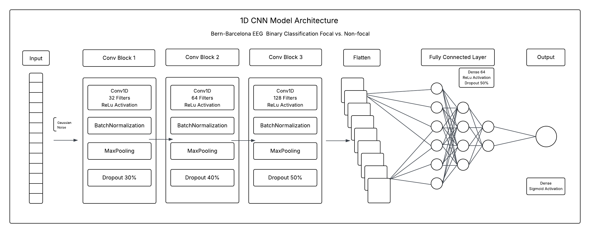
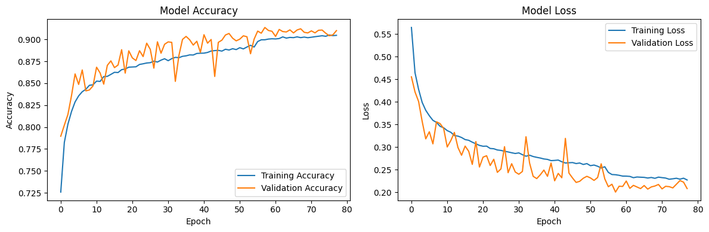
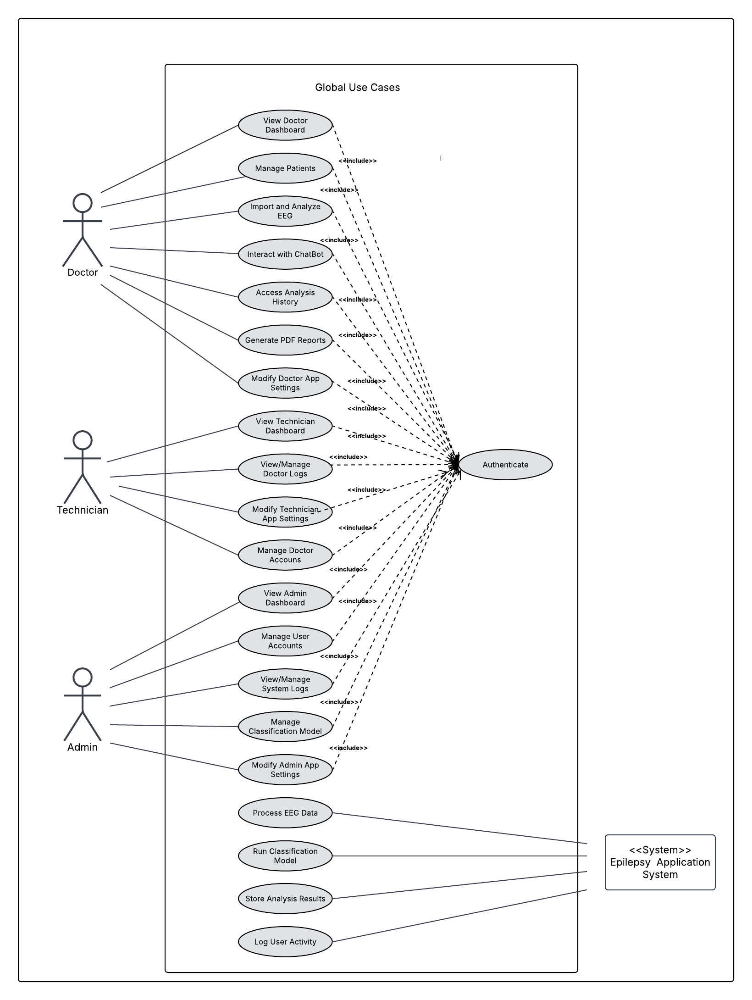
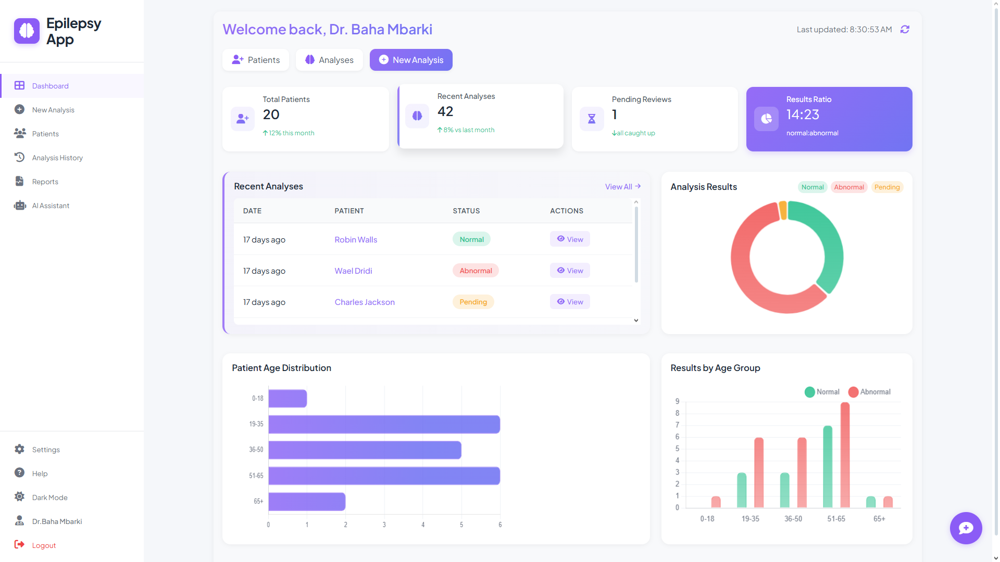
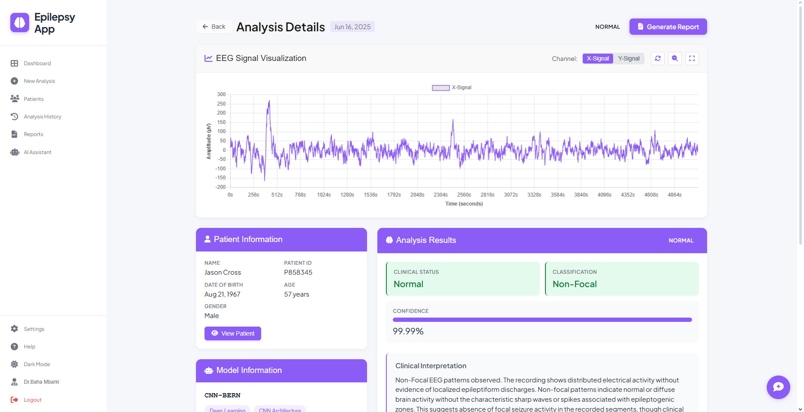
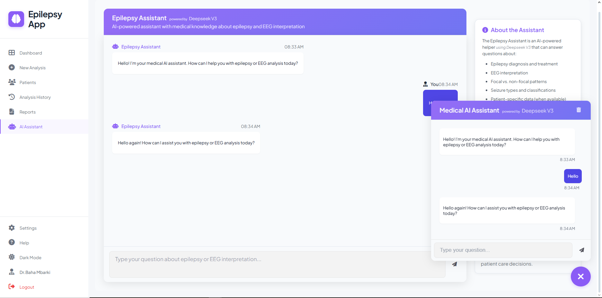
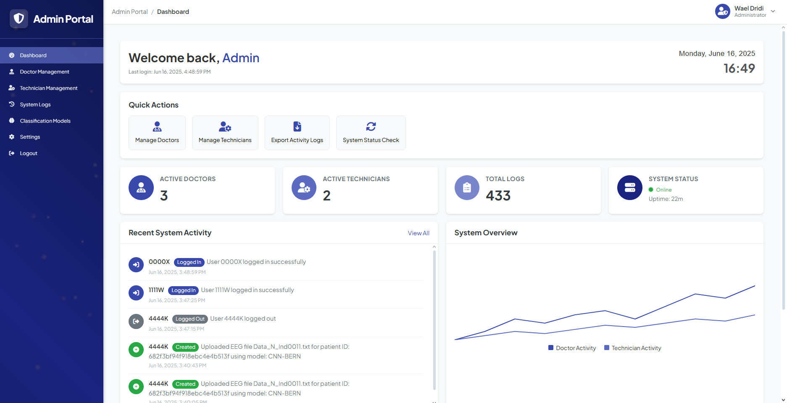

# Epilepsy EEG AI — Full-Stack Clinical Decision Support Platform

> **End-to-end focal vs. non-focal epilepsy EEG classification, clinical workflow management, and medical RAG assistant** — developed as an AI/Data Science graduation thesis (PFE) with **RISC Lab (ENIT)** in clinical collaboration with the **Neurology Department of Razi Hospital (Tunis, Tunisia)**.

[](https://python.org)
[](https://fastapi.tiangolo.com)
[](https://angular.dev)
[](https://tensorflow.org)
[](https://mongodb.com)
[](LICENSE)

---

## Clinical Problem & Solution

Manual review of long-term intracranial EEG recordings for **focal epilepsy** localization is time-consuming and prone to inter-observer variability. This platform automates seizure-onset signal screening while keeping neurologists in full clinical control:

- **Deep Learning EEG Inference (`backend/models/`)**: Custom **1D-CNN** trained on **85,500 segmented EEG signals** from the [Bern-Barcelona Intracranial EEG Dataset](https://www.upf.edu/web/ntsa/downloads) (focal vs. non-focal classification), featuring a **hot-swappable ML model registry** (`CNN-BERN.h5` included) so new `.h5` models can be uploaded, validated, and promoted via API.
- **Three Role-Based Clinical Portals (`frontend/`)**:
  - **Doctor Portal**: Patient records, EEG upload & automated inference, signal visualization, clinical PDF report generation (ReportLab), and Gmail OAuth2 / SMTP report sharing.
  - **Technician Portal**: EEG acquisition intake, patient onboarding, and doctor assignment workflows.
  - **Admin Portal**: User & permission-group RBAC management, audit logs, and ML model registry administration.
- **Medical RAG Clinical Assistant (`backend/app/utils/rag_service.py`, `chat_service.py`)**: Context-aware neurology chatbot combining **LangChain**, **FAISS** (`all-MiniLM-L6-v2` embeddings), MongoDB patient/analysis lookup, and **OpenRouter** LLM inference (`qwen/qwen3-235b-a22b:free` configurable).

---

## Model Performance (Bern-Barcelona EEG)

Evaluated on held-out test segments from 85,500 EEG windows (comparing 1D-CNN against recurrent baselines):

| Model Architecture | Test Accuracy | Recall (Sensitivity) | ROC-AUC | Relative Training/Inference Speed |
| :--- | :---: | :---: | :---: | :---: |
| **1D-CNN (`CNN-BERN.h5`)** | **91.28%** | **93.03%** | **0.9761** | **Baseline (3–4x faster)** |
| LSTM / GRU Baselines | ~84.4% | — | — | 3–4x slower |

<p align="center">
  
  
</p>

---

## System Architecture & Screens

### Use Case & 3-Tier Modular Monolith

```text
epilepsy-eeg-ai/
├── frontend/                  # Angular 18 SPA (Doctor, Technician, Admin portals)
├── backend/
│   ├── app/
│   │   ├── main.py            # FastAPI app, CORS, Session & JWT RBAC middleware
│   │   ├── models/            # Pydantic schemas & permission groups
│   │   ├── routes/            # Auth, Google OAuth, Patients, Analyses, Reports, Chat, Logs, Models
│   │   └── utils/             # Inference, ReportLab PDF, RAG/FAISS, OpenRouter, Email
│   ├── models/                # CNN-BERN.h5 weights, preprocessor, inference & training scripts
│   ├── rag/                   # Drop clinical PDFs here to auto-build FAISS index
│   ├── scripts/               # MongoDB collection setup & synthetic seed scripts
│   └── .env.example           # Environment template
├── samples/                   # 2 sample Bern-Barcelona EEG .txt files (focal & non-focal)
└── docs/figures/              # Architecture & UI screenshots
```

<p align="center">
  
</p>

### Clinical Portal Previews

| Doctor Dashboard | EEG Analysis Result |
| :---: | :---: |
|  |  |

| Medical RAG Assistant | Admin Portal |
| :---: | :---: |
|  |  |

---

## Quick Start

### Prerequisites
- **Python 3.11+** & **Node.js 18+ / Angular CLI 18**
- **MongoDB** (local instance or MongoDB Atlas)

### 1. Backend (FastAPI + TensorFlow + RAG)

```bash
cd backend
python -m venv .venv
# Windows: .venv\Scripts\activate  |  macOS/Linux: source .venv/bin/activate
pip install -r requirements.txt

cp .env.example .env
# Edit .env with your MONGO_URI, JWT secrets, and optional OPENROUTER_API_KEY / Google OAuth keys

# Initialize collections & optional demo users
python scripts/setup_database.py

# Start API server (http://localhost:8000/docs)
uvicorn app.main:app --reload --port 8000
```

> **Testing EEG inference:** Upload `samples/focal_eeg_sample.txt` or `samples/non_focal_eeg_sample.txt` from the Doctor portal or `/api/analyses/` endpoint.  
> **Medical RAG:** Place clinical epilepsy PDFs inside `backend/rag/` — `RAGService` indexes them automatically with `all-MiniLM-L6-v2` + FAISS on first query.

### 2. Frontend (Angular 18)

```bash
cd frontend
npm install
npx ng serve
```

Open `http://localhost:4200/` in your browser.

---

## Dataset Attribution & Disclaimer

- **Dataset**: Sample EEG signals and trained weights are derived from the [Bern-Barcelona EEG Database](https://www.upf.edu/web/ntsa/downloads) (Andrzejak et al., *Physical Review E*, 2012). Full dataset files are excluded from this repository; download directly from UPF to retrain via `backend/models/CNN-BERN_training.py`.
- **Medical Disclaimer**: This software is a research and clinical decision-support prototype developed for academic purposes. It is **not** a certified medical device and must not be used for standalone clinical diagnosis.

---

## Author

**Wael Dridi** — Master's Student in Big Data Analytics @ IHEC Carthage  
[GitHub](https://github.com/Waelxz) · [LinkedIn](https://www.linkedin.com/in/dridiwael) · `wael.dridi.m2025@ihec.ucar.tn`
